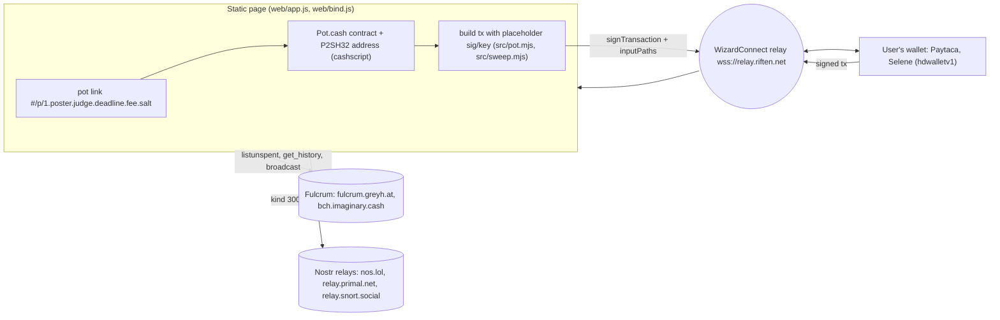

# Architecture

Pot is three things: a CashScript contract, a static web page, and the user's own wallet. There is no backend, no
database, no account and no indexer. Everything a pot is lives in its link and on chain.

## The contract (`contracts/Pot.cash`, 15 `require`s)
`Pot(bytes20 posterPkh, pubkey judgePk, int deadline, int maxFee, bytes8 salt)`, compiled with cashc 0.14 to a P2SH32
address. The five constructor values are the pot's whole state; they never change. `salt` is 8 random bytes per pot
(`newSalt()` in `src/pot.mjs`), so two pots with the same terms still get different addresses.

| Path | Who signs | What the contract enforces |
|---|---|---|
| **Top-up** | anyone | nothing: a plain payment to the address. The first pay-in carries an OP_RETURN `POT1 <title> <url>` (≤ 223 bytes, `src/potread.mjs`); the page takes the title only from a pay-in by the poster's key or one whose change pays the poster. |
| **`award(judgeSig)`** | judge | judge signature; exactly one output, not the poster's or the judge's P2PKH; every input is this same contract; output ≥ sum of inputs − `maxFee`. The judge picks the winner but can't skim, split or pay themselves. |
| **`refund(posterPk, posterSig)`** | poster | `hash160(posterPk) == posterPkh`; `tx.time >= deadline` (a block height, so locktime ≥ deadline); one output, to the poster's P2PKH; same all-inputs and fee-cap rules. |

Award and refund sweep every coin they include, so top-ups are paid out with the original pot. The page caps a sweep
at what fits under `maxFee` (5,000 sats: ~15 coins for an award, 13 for a refund, `src/sweep.mjs`). Limits are listed
plainly in the README self-audit.

## The page (`web/`, logic in `src/`)
- **Indexer-free state.** `decodePotLink()` (`src/pot.mjs`) turns the link into the constructor arguments; `potContract()`
  rebuilds the contract and its address. `src/potread.mjs` reads the address's coins and history straight from a
  Fulcrum server (`blockchain.scripthash.listunspent` / `get_history` / `transaction.get`), classifies each tx (fund,
  top-up, award, refund) and reads the POT1 title. Balance, deadline and history are always live chain data.
- `src/net.mjs`: mainnet (default) and chipnet (`?net=chipnet`), Fulcrum failover (mainnet `fulcrum.greyh.at` then
  `bch.imaginary.cash`), explorer links, and address checks that name the wrong network. Failover happens only on a
  connection problem; a node's rejection (`bad-txns-*`, `(code N)`) passes through, so the page shows the real reason.
- Fees are exact: transactions are built with CashScript's placeholder signature and key, which have the size of the
  real ones (`buildPayment`, `buildSweep` in `src/pot.mjs`), at 1 sat/byte.
- Pots you create or open are remembered in this browser's localStorage, per network. Nothing is sent anywhere else.

## The wallet flow (WizardConnect hdwalletv1, `web/app.js`)
1. **Pairing.** The page opens a relay session (`wss://relay.riften.net`) and shows a QR and a `wiz://` link.
2. The wallet answers `wallet_ready` with its xpubs. The page derives `receive/0` (the user's address and judge key)
   and reads coins on the first 10 receive and change addresses. Selene sends `wallet_ready` more than once and the
   first may carry no keys, so the page waits up to 15 s for one with a receive key.
3. **Network check.** WizardConnect has no network field, so a `tpub` is refused on mainnet, and a wallet with no coins
   here but coins on the other network is refused with a link to the right page.
4. **Signing.** Each action becomes `dapp.signTransaction(wcRequest(wcObj, inputPaths))`. `wcRequest()` (`src/pot.mjs`)
   sends the unsigned tx hex, every source output (with `abiFunction`, `redeemScript` and contract name for a contract
   input), a one-line `userPrompt` (e.g. "Award the pot: 0.0002 BCH to bitcoincash:q…"), and `inputPaths`:
   `[inputIndex, "receive"|"change", addressIndex]` per input. Create and top-up list the wallet coins they spend;
   award and refund list every contract input with the judge's or poster's key path (`receive/0`), so the wallet signs
   the CashScript input itself. The page broadcasts the signed tx. A rejection shows "The wallet didn't sign. Nothing
   was sent."
5. The session is kept in localStorage per network, so a reload resumes it without a new QR.

**Verified on mainnet** (txids in the README): Paytaca extension 0.27.5 signed create, top-up, award (two contract
inputs in one tx), refund after the deadline, and a `wc-tx` identity proof. Selene web v2026.10.02 created a pot and
signed its award as judge. The `@wizardconnect/wallet` test wallet (`e2e/wallet.mjs`) runs every path on chipnet.

## Nostr identity binding (`nostr-bch-bind v1`, Paytaca DID)
`src/bindverify.mjs` (verify, offline), `src/nostrbind.mjs` (relays, resolve), `web/bind.js` (the `#/bind` view, badges).
- **Message** both keys sign: `nostr-bch-bind:v1\nnpub:<hex>\nbch:<cashaddr>\ncreated:<unix>`.
- **Nostr side**: a kind 30078 event, `d` = `bch-bind:<addr>`, `i` = `bch:<addr>` (relay-indexed, so lookup works from
  the address or the npub), `proof` = [kind, value]. Its NIP-01 signature is proof 1.
- **BCH side**, proof 2: a wallet `signmessage` signature, or `wc-tx`: a tx signed over WizardConnect that spends one coin
  of the address to an OP_RETURN `"nostr-bch-bind:v1" <sha256(message)>` plus change to the same address, with locktime
  4102444800 (year 2100) and a non-final sequence, so it can never be mined (`buildBindProof`). The verifier runs it in
  libauth's BCH VM against its source output (`verifyWcTx`).
- **Valid** when the event signature, proof 2 over the same message, and the content/`d`/`i` fields all agree and
  `created` is within 5 min of `created_at`; the latest valid binding wins and a newer `revoked` one removes it
  (`resolve`). Events are verified as a fresh copy of the wire fields (nostr-tools caches a pass on the object).
- **Use in Pot**: poster and judge get a verified npub badge (it opens `#/bind?q=<npub>` with every check shown); the judge and winner fields accept an npub, resolved and
  re-verified at award time. pennyops `bch-nostr-bind.v1` events are verified too; kind 31234 bridge events have no BCH
  proof and show as unverifiable. The Nostr secret stays in a closure (never the DOM or localStorage).

- **Login** (`src/login.mjs`, the `#/bind` login box): challenge `nostr-bch-bind:login:v1\ndomain:<app>\nnpub:<hex>\nnonce:<16 random bytes hex>\nissued:<unix>`
  (~175 bytes, under the 253-byte signmessage limit; it can never parse as a binding message). `makeLoginVerifier({domain})`
  keeps the nonces it issued; `verify` accepts one only for its own domain, issued by it, unused, at most 300 s old (30 s
  skew), with a valid binding of that npub and a `signmessage`/`wc-tx` proof by the bound address over the exact text.
  A success consumes the nonce (replay refused); a failed signature leaves it for a retry; an expired one is dropped.

## Tests
- `npm test` (118 cases, mock network): every contract rule (each rejected case names its Pot.cash line), the sweep
  planner, the app's transactions, the identity vectors (incl. the real mainnet binding), the login (valid signmessage
  and wc-tx, wrong address, another npub's binding, expired, replayed, forged, foreign domain, garbage proofs), and the
  network layer.
- `npm run e2e`: the built page in headless Chrome against chipnet with a test wallet over the real relay: pairing,
  create, a rejected request, resume after reload, top-up, a wallet-signed binding (refused by the network as
  non-final), award of two coins, refund, and the mainnet page refusing a testnet wallet.
